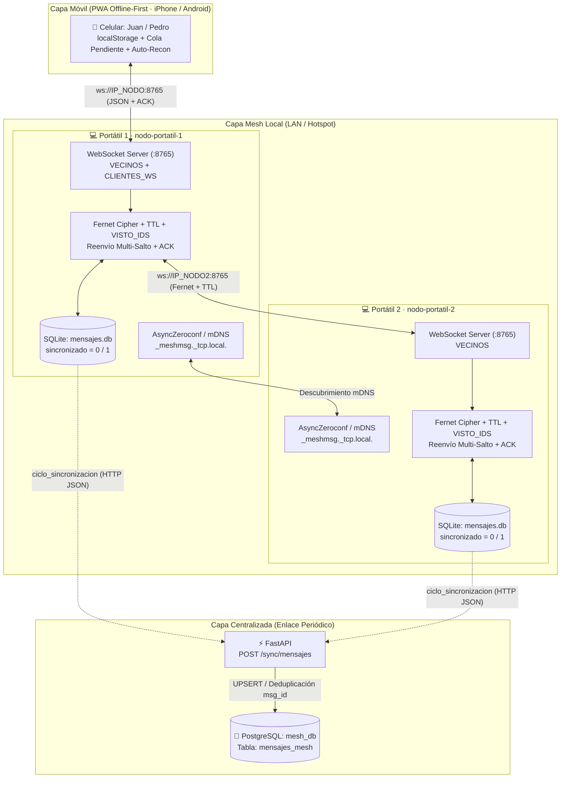
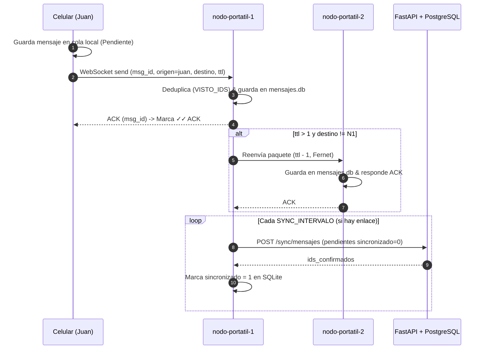

## Arquitectura del Sistema Mesh Híbrido

## Flujo de Mensajería y Sincronización (Secuencia)

Estructura del Proyecto

nodo.py: Nodo principal de la malla (mDNS, servidor/cliente WebSocket en puerto 8765, cifrado Fernet, persistencia local en SQLite y sincronización en segundo plano).

servidor_sync.py: API central en FastAPI que recibe lotes pendientes y realiza UPSERT idempotente en PostgreSQL.

app_movil/: Cliente móvil PWA (index.html, manifest.json, sw.js) instalable en iPhone y Android con nombres personalizados y cola offline.

Guía Rápida de Arranque

1. Servidor de Sincronización Central (FastAPI + PostgreSQL)

uvicorn servidor_sync:app --host 0.0.0.0 --port 8000

2. Nodos Portátiles en la Malla

En el Portátil 1 (NODE_ID = "nodo-portatil-1"):

python nodo.py

En el Portátil 2 (NODE_ID = "nodo-portatil-2"), apuntando al servidor central:

$env:SYNC_URL="http://IP_SERVIDOR:8000/sync/mensajes"
python nodo.py

3. App Móvil (PWA para iPhone y Android)

Servir la carpeta app_movil en la red local:

cd app_movil
python -m http.server 8080 --bind 0.0.0.0

Luego abrir http://IP_PORTATIL_1:8080 desde el navegador del celular, configurar el nombre de usuario (por ejemplo Juan o Pedro) y la dirección ws://IP_PORTATIL_1:8765 en ⚙️, y seleccionar Agregar a pantalla de inicio.
